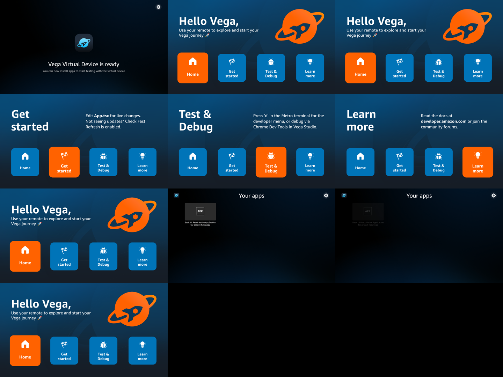

# vega-vvd-ci

**Build an Amazon Vega OS (Fire TV) React Native app and run it on the Vega Virtual Device (VVD) — headlessly, on a free GitHub-hosted runner — then capture screenshots, a 1080p screen recording and scripted D-pad (remote) input.**

No Docker. No GPU. No self-hosted runner. No Mac. One `ubuntu-24.04` job: **~7 min cold, ~4 min with the SDK cache warm** (install → build → boot → launch → demo → upload).



*Every frame above was captured on a GitHub-hosted runner: VVD home → app launched → D-pad right/left moves focus → Home → launcher.*

▶ **See it used for a real app:** [Cast to Your TV for Fire TV: Ask the TV](https://github.com/OlsOls4/casttoyourtv-firetv) was built, tested and filmed entirely with this action. Demo video (all footage recorded by vega-vvd-ci in GitHub Actions): https://youtu.be/uGa3gNCsfk4

## Why

The Vega SDK only installs on x86_64 Ubuntu (20.04/22.04/24.04) or macOS, and the VVD needs KVM. That rules out ARM Linux boxes, most cloud dev sandboxes and AI-agent sandboxes. GitHub's Linux runners have KVM, but there's no official "run the VVD in CI" recipe, and the obvious `vega virtual-device start --no-gui` boots a device whose screenshots come back **black**. This repo packages the working recipe as a composite action plus small scripts.

## What works (verified in CI, SDK 0.24.12112 / CLI 1.4.5)

| Capability | How | Status |
|---|---|---|
| Install SDK + VVD unattended | `NONINTERACTIVE=true bash get_vvm.sh` | ✅ ~3.5 min cold (6.2 GB); ~1 min from `actions/cache` (2.1 GB compressed) |
| Build a vpkg | `vega project generate` → `npm install` → `npm run build:release` | ✅ ~1 min |
| Boot VVD headless | Xvfb + Mesa llvmpipe + relaunch the emulator with `-gpu host` | ✅ ~60 s to home screen |
| Install + launch the app | `vega run-app <vpkg> <appId> -d VirtualDevice` | ✅ ~4 s |
| Screenshot (PNG, 1920×1080) | emulator console `screenrecord screenshot <dir>` | ✅ |
| Screen recording | emulator console `screenrecord start/stop` → WebM (VP9) → MP4 | ✅ full-motion 1080p, ≤180 s per clip |
| Remote / D-pad keys | `vega exec vda shell inputd-cli button_press KEY_RIGHT` | ✅ focus moves in the app and launcher |

## Use it in your own repo

```yaml
jobs:
  vvd:
    runs-on: ubuntu-24.04
    timeout-minutes: 60
    defaults: { run: { shell: "bash -eo pipefail {0}" } }
    steps:
      - uses: actions/checkout@v4
      - uses: actions/setup-node@v4
        with: { node-version: "22" }   # react-native-kepler 4.x wants Node >= 22.14

      - uses: OlsOls4/vega-vvd-ci@main      # KVM + deps + Vega SDK + VVD boot (background)
        with:
          boot: background                  # background | foreground | none
          # sdk-version: 0.24.12112         # blank = latest

      - run: npm ci && npm run build:release   # your Vega app, built while the VVD boots
      - run: wait-vvd.sh 600
      - run: |
          vega run-app build/x86_64-release/myapp_x86_64.vpkg com.example.myapp.main -d VirtualDevice
          record.sh start "$OUT/demo.webm"
          sleep 10; screenshot.sh "$OUT/launched.png"
          press.sh right right select back
          record.sh stop
          ffmpeg -y -i "$OUT/demo.webm" -c:v libx264 -pix_fmt yuv420p "$OUT/demo.mp4"
      - uses: actions/upload-artifact@v4
        if: always()
        with: { name: vvd, path: artifacts/ }
```

The action puts `scripts/` on `PATH` and sets `OUT` (artifacts dir) and `DISPLAY`.

## Scripts

| Script | What it does |
|---|---|
| `start-vvd.sh` | Starts Xvfb + llvmpipe, lets `vega virtual-device start` create the instance, reads the emulator argv from `/proc`, kills it and relaunches the same binary with `-gpu host`; waits for a non-black frame and for `vda` to see `emulator-5554`. |
| `wait-vvd.sh [secs]` | Waits for a background boot to finish. |
| `screenshot.sh out.png` | PNG via the emulator console. |
| `record.sh start f.webm` / `record.sh stop` | Screen recording via the emulator console (`--time-limit`, max 180 s; set `REC_LIMIT`). |
| `press.sh up down left right select back home menu playpause …` | Remote keys via on-device `inputd-cli` (raw `KEY_*` codes also accepted; `PRESS_GAP` seconds between presses). |
| `vvd-console.py "cmd" …` | Send any emulator-console command. |
| `build-app.sh` | Scaffold (template) + build; copies `app-overlay/` over the template if present. |
| `run-demo.sh` | The demo used by this repo's workflow: launch, walk focus across the tiles, Home, relaunch; step screenshots + recording + slideshow MP4. |
| `stop-vvd.sh` | Stop the emulator (lets `~/vega` be cached). |

## Measured timings (4 vCPU / 16 GB `ubuntu-24.04` runner)

| Run | SDK | Total job |
|---|---|---|
| Cold (no cache) | installed, 207–214 s | 425–478 s |
| Warm (`~/vega` restored from cache) | 0 s install | 227 s |

Boot to non-black home screen: 54–61 s. App install + launch: 3–4 s. Build (3 arches, release): ~60 s, overlapped with the boot.

## Run it here

Push to `main`, or **Actions → "Vega VVD — build, boot, run, record" → Run workflow** (inputs: SDK version, template). Download the `vvd-artifacts` artifact:

```
artifacts/
  shots/NN-*.png          step screenshots (1920×1080)
  demo-console.webm/.mp4  full-motion recording of the whole demo
  demo-slideshow.mp4      2 s per step screenshot
  hellovega_x86_64.vpkg   the built app
  logs/                   emulator, CLI, build, help output, emulator argv
```

## Gotchas we hit (so you don't)

- **Black screenshots** with the CLI's default GPU mode (`swangle_indirect`). Only `-gpu host` (backed by Mesa llvmpipe on Xvfb) posts a colour buffer the console can read back. The CLI has no flag for it, hence the relaunch.
- **Don't** use QMP `screendump`. It reads the scanout and is always black. The on-device `gwsi-tool-screenshooter` isn't supported on VVD.
- `inputd-cli` worked over `vda shell` on a fresh 0.24 VVD **without** `vsm developer-mode enable`. `enable-devmode.sh` probes first and only enables it (VVD reboots) if needed.
- Key names: select = `KEY_ENTER`, home = `KEY_HOMEPAGE`.
- `ffmpeg -f x11grab` of the Xvfb display came out black even with the emulator window enabled. Use the console recorder.
- GitHub's default `bash -e` has no `pipefail`, so `script | tee log` hides failures. Set `shell: bash -eo pipefail {0}`.
- `actions/cache` of `~/vega` fails while the emulator is running (files change under tar). Stop the VVD first (`stop-vvd.sh`).

## Credits

The `-gpu host` + llvmpipe + relaunch technique was worked out by [finloop/vega-virtual-device-action](https://github.com/finloop/vega-virtual-device-action) (a Docker-based action). The `inputd-cli` key mapping comes from [software-mansion/argent](https://github.com/software-mansion/argent). This repo is a Docker-free take, runnable directly on the runner, and adds screen recording and a D-pad demo.

Vega SDK © Amazon, under its own licence. It's downloaded at run time and not redistributed here.

## Licence

MIT
